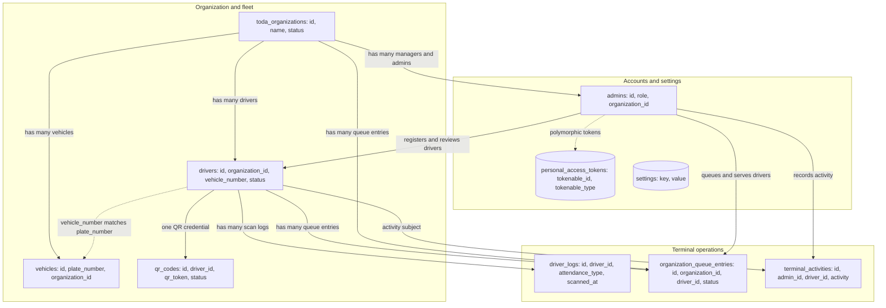
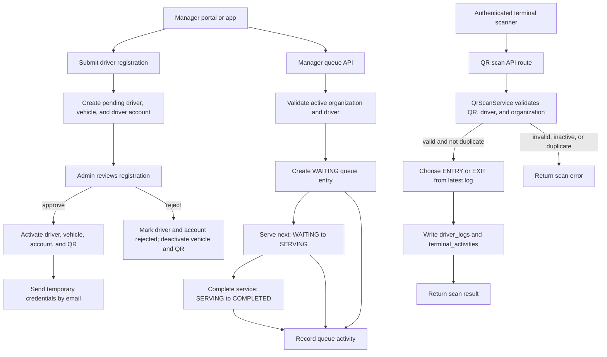

# ScanTrack System Schema and Flow

This document maps the main persisted entities and the application flows that create or update them. Solid relationships represent database foreign keys; dotted relationships are application-level conventions or lookups.

## Data Schema

<!-- mermaid-checked: no \n, no em-dash/en-dash, no {} in labels, subgraphs are id["label"], arrows are -->|"label"|, all subgraphs closed by end, ids unique -->

### Relationship Notes

- `drivers.organization_id`, `vehicles.organization_id`, the QR/log/queue references, and activity actor references are backed by foreign keys in migrations.
- A driver has at most one QR row (`qr_codes.driver_id` is unique). Queue rows retain the organization, driver, queue number, status, manager, and serving timestamps.
- Driver-to-vehicle association is resolved by matching `drivers.vehicle_number` to unique `vehicles.plate_number`; it is not declared as a foreign key.
- Driver login accounts are stored in `admins` with role `Driver`. The registration flow finds them using `user_id = DRIVER-<driver id>`; migrations do not define a foreign key from that account to `drivers`.
- `personal_access_tokens` uses Laravel's polymorphic token ownership, so it can store tokens for multiple authenticatable model types.
- `settings` is a key/value table and has no relationship to the operational records.

## System Flows

<!-- mermaid-checked: no \n, no em-dash/en-dash, no {} in labels, subgraphs are id["label"], arrows are -->|"label"|, all subgraphs closed by end, ids unique -->

### Flow Summary

- Manager or admin registration stores a pending driver, vehicle, and driver-role account. Admin approval activates those records, issues or reactivates a QR credential, records terminal activity, and emails temporary credentials.
- QR scans require authenticated admin access. The scan service validates the QR and related active records, rejects scans within the duplicate-scan window, alternates `ENTRY` and `EXIT`, then writes the scan log and audit activity in a transaction.
- Managers enqueue active drivers in their organization. Queue entries progress through `WAITING`, `SERVING`, and `COMPLETED`; each transition is accompanied by a terminal activity record.
